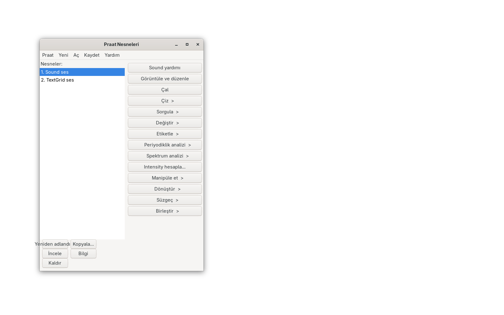
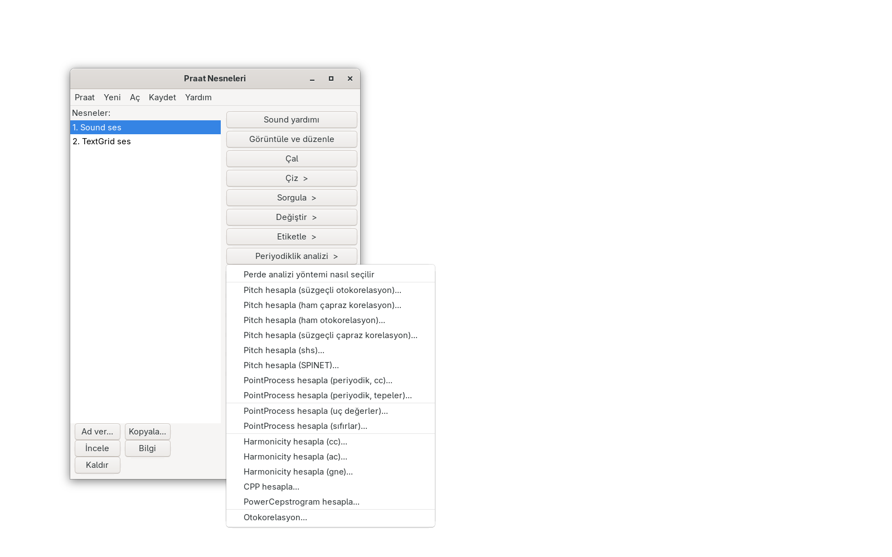
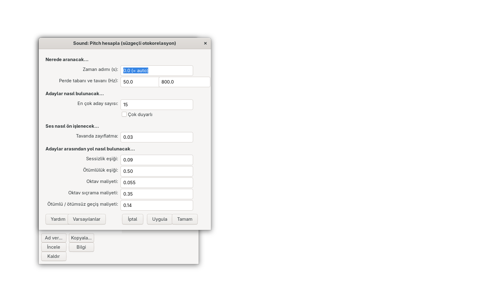

# Praat Türkçe arayüz

Bu depo, Praat'ın (konuşma analizi ve fonetik programı, https://praat.org) arayüzünü Türkçeye çevirmek için tutuluyor. Praat'ın kendi kaynak koduna çok küçük bir çeviri katmanı ekleniyor, çeviriler tek bir sözlük dosyasında duruyor.






## Nasıl çalışıyor

- `sys/Gui_ceviri.cpp` dosyasındaki `Gui_tr ()` fonksiyonu, menü, düğme, etiket ve pencere başlığı ekrana yazılırken İngilizce metni sözlükte arar. Karşılığı varsa Türkçesini gösterir, yoksa İngilizce bırakır.
- Sözlük `ceviri/ceviri_tr.tsv` dosyası. Her satırda İngilizce metin, bir sekme ve Türkçe karşılık var.
- Bilgi penceresi için iki özel satır türü var. `@sözcük` satırları değerlerin içindeki birimleri çevirir (`@seconds` için "saniye"). `~kalıp` satırlarında `*` herhangi bir değeri yakalar: `~From * to * seconds (duration: * seconds)` karşılığı `* ile * saniye arası (süre: * saniye)`.
- `%f` gibi biçim işaretleri karşılıkta aynı sayıda bulunmalı, yoksa satır atlanır.
- Komutların iç adları değişmiyor. Praat scriptleri (`To Pitch...`, `selectObject: ...`) Türkçe arayüzde de aynen çalışır. "Paste history" İngilizce komut adlarını verir.
- Praat varsayılan olarak Türkçe açılır. İngilizceye geçmek için **Praat > Ayarlar > Arayüz dili...** menüsünden "İngilizce" seçilir, değişiklik Praat yeniden açılınca geçerli olur. İngilizce arayüzde aynı komut "Praat > Settings > Interface language..." adıyla durur, Türkçeye dönmek için oradan "Turkish" seçilir. Seçim `~/.config/praat/ceviri_ayar.txt` dosyasında tutulur. Scriptten de değiştirilebilir: `Interface language: "English"`.
- Sözlük dosyası kurulu değilse Praat tamamen İngilizce açılır. Tek bir açılış için çeviriyi kapatmak isterseniz `PRAAT_CEVIRI=0 ./praat` yeterli.

Upstream koduna dokunulan yerler: `sys/` altındaki 10 Gui dosyasında `Melder_peek32to8 (x)` çağrıları `Melder_peek32to8 (Gui_tr (x))` hâline getirildi, `GuiP.h` bir satır `#include` aldı, `sys/Makefile` ve `sys/meson.build` yeni dosyayı tanıdı. Bu değişiklikler küçük olduğu için upstream güncellemeleri birleştirilirken çakışma riski düşük.

## Kurulum (Linux)

Gerekenler (Arch): `gtk3`, `libpulse`, `alsa-lib`, `jack2` (ya da `pipewire-jack`), `gcc`, `make`, `pkgconf`.
Ubuntu ya da Debian için `HOW_TO_BUILD_ONE.md` dosyasındaki paket listesine bakın.

```sh
git clone https://github.com/Underday/Praat-turkish.git
cd Praat-turkish
git checkout turkce
make -j$(nproc)          # ./praat dosyası oluşur
ceviri/kur.sh            # sözlüğü ~/.config/praat/ceviri_tr.tsv olarak bağlar
./praat
```

`ceviri/kur.sh --kaldir` sözlüğü kaldırır, Praat yeniden İngilizce açılır. Sözlük başka bir yerdeyse `PRAAT_CEVIRI=/yol/ceviri_tr.tsv ./praat` ile verilebilir.

## Windows

Zip'i açıp `Praat.exe` dosyasını çalıştırmak yeterli, kurulum gerekmez. Sözlük (`ceviri_tr.tsv`) `Praat.exe` ile aynı klasörde durmalı. Program imzasız olduğu için Windows ilk açılışta uyarı verebilir ("Ek bilgi", sonra "Yine de çalıştır").


Zip iki yoldan üretilebilir:

- Linux'ta: `ceviri/windows/derle.sh` (Arch'ta `mingw-w64-gcc` paketi gerekir). Çıktı `../praat-win/dagitim/` altına yazılır.
- GitHub Actions'ta: `windows-` ile başlayan bir etiket push edilince `.github/workflows/windows-turkce.yml` çalışır (MSYS2 UCRT64, yaklaşık 20 dakika), zip iş akışının "Artifacts" bölümünden indirilir. Örnek: `git tag windows-v0.5 && git push origin windows-v0.5`.

Windows sürümü şimdiye kadar yalnızca Wine altında denendi.

## Çeviriye katkı

1. Terim seçimleri `TERIMLER.md` dosyasında. Yeni bir terim önce oraya yazılır.
2. Çevrilmemiş etiketleri toplamak için Praat'ı şöyle açın, istediğiniz pencereleri ve menüleri gezin:
   ```sh
   PRAAT_CEVIRI_EKSIK=/tmp/eksik.txt ./praat
   ```
   Sözlükte karşılığı olmayan her etiket `/tmp/eksik.txt` dosyasına bir kez yazılır.
3. Karşılığı `ceviri/ceviri_tr.tsv` dosyasına ekleyin. Kurallar:
   - İngilizce ve Türkçe arasında tek bir sekme karakteri olmalı.
   - "..." ile biten komutun Türkçesi de "..." ile bitmeli (diyalog açtığını gösterir). ":" ve " -" ekleri için de aynı kural geçerli. Eksik bırakılırsa program eki kendisi ekler ve uyarı yazar.
   - Ekli biçimi ayrıca yazmaya gerek yok. "Get formant" çevrildiyse "Get formant..." da çevrilmiş olur.
   - Baştaki girinti boşlukları yazılmaz.
   - Nesne adları (Sound, TextGrid, Pitch, Intensity, Formant...) İngilizce kalır.
4. Praat'ı yeniden açmak yeterli, derleme gerekmez.

## Benzer çalışma: Özelleştirilmiş Praat (Kılıç, 2014)

Kılıç'ın "Klinik Fonetik ve Ağız Araştırmaları İçin Özelleştirilmiş Praat Programı" paketi (Praat.ozel 3.1) Praat 5.3.57 üzerine kurulu bir eklenti ve ayar paketidir. Nesneler penceresine Türkçe adlı düğmeler ekler (ses kalitesi ölçümü, CPP, VoiceSauce, toplu formant, perde ve spektral moment ölçümü), IPA yazımı için Lenz programını ve fontları, örnek ses ve TextGrid dosyalarını birlikte dağıtır.

Bu depo ondan şu noktalarda ayrılıyor:

| | Praat.ozel 3.1 (2014) | Bu depo |
|---|---|---|
| Ne yapıyor | Praat'a Türkçe adlı yeni düğmeler ve scriptler ekliyor | Praat'ın kendi arayüzünü Türkçeye çeviriyor |
| Praat'ın menüleri, diyalogları, düzenleyicisi | İngilizce kalıyor (New, View & Edit, OK) | Türkçe |
| Bilgi penceresi çıktısı (ses raporu) | İngilizce, eklenen scriptlerin çıktısı Türkçe | Ekranda Türkçe, scriptlere giden metin İngilizce |
| Praat sürümü | 5.3.57'ye bağlı, paket başka bir sürümle eklentilerin çalışmayabileceğini belirtiyor | Güncel sürüm (7.0.03), upstream güncellemeleri birleştirilebiliyor |
| Kurulum | Ayar dosyalarını elle kopyalama | Tek sözlük dosyası ve `kur.sh` |
| Terimler | Belgelenmemiş | `TERIMLER.md` ile gerekçeli |
| Platform | Windows ve macOS | Şimdilik Linux |

İki iş birbirini tamamlıyor. Bu depo arayüzü çeviriyor, Praat.ozel ise klinik ölçümler için hazır araçlar sunuyor. Klinik kısayollar ileride ayrı bir eklenti (plugin) olarak eklenebilir.

Kaynak: Kılıç, M. A. (2014). Özelleştirilmiş Praat programı ile uygulama. Konuşma ve Dil Bozukluklarını Anlamak: Klinik Fonetik ve Dilbilim Kursu (27-31 Ocak 2014), İstanbul.

## Bilinen sınırlar

- Çeviri metne bakıyor, bağlama bakmıyor. Aynı İngilizce sözcük her yerde aynı Türkçe karşılığı alır.
- Bilgi penceresi yalnızca ekranda çevriliyor. Scriptlerin `info$ ()` ile okuduğu metin İngilizce kalıyor, ancak Bilgi penceresinden kopyalanan ya da "Farklı kaydet" ile kaydedilen metin Türkçe olur. Kendi scriptinizin yazdırdığı satırlar da sözlükteki bir etiketle başlıyorsa Türkçe görünür. Bilgi penceresi çevirisini kapatmak için `PRAAT_CEVIRI_BILGI=0 ./praat`.
- Düzenleyicinin çizim alanında açıklamalar ("türetilmiş spektrogram") ve süre çubukları çevriliyor. Eksen yazıları, Çizim penceresine çizilen yazılar, hata mesajları ve kılavuz sayfaları çevrilmiyor.
- Linux'ta ve Windows'ta (Wine altında) denendi. macOS tarafı henüz bağlanmadı.

## Lisans

Praat GPL lisanslıdır (`README.md`). Bu depodaki çeviri katmanı ve sözlük de GPL 3 ya da sonrası ile dağıtılır.
