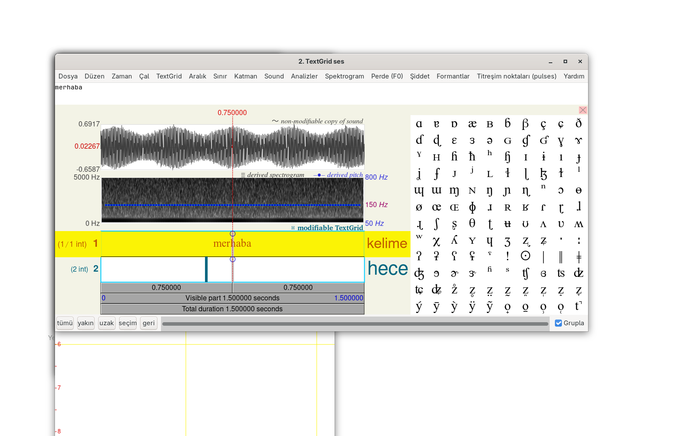
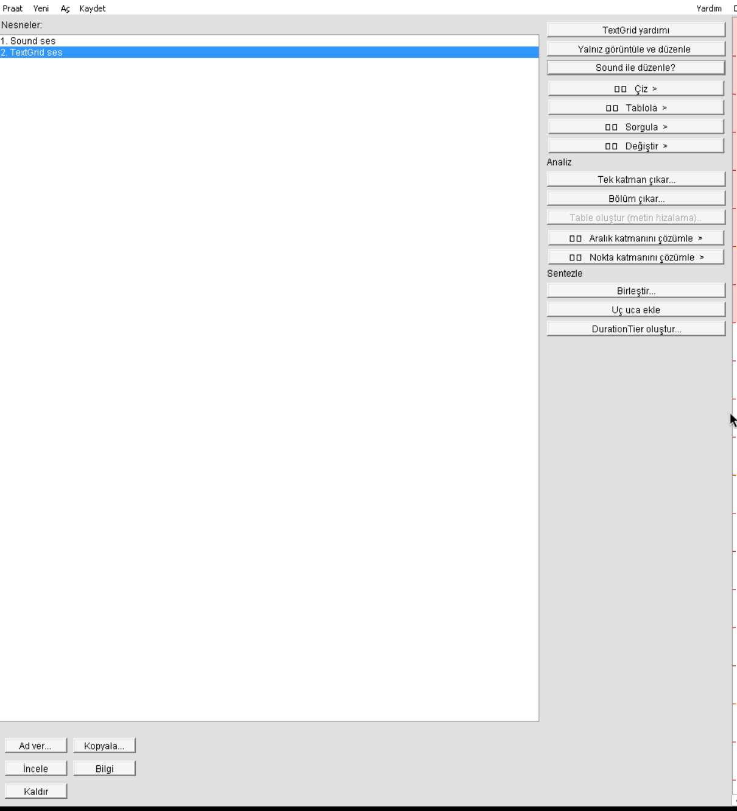
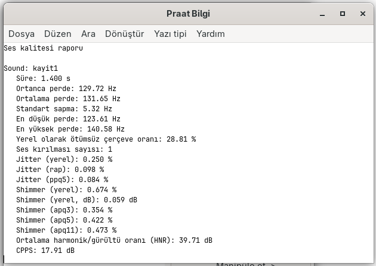

# Praat Türkçe arayüz

[](https://doi.org/10.5281/zenodo.24525320) [](https://underday.github.io/Praat-turkish/) [](https://github.com/Underday/Praat-turkish/blob/main/LICENSE)

Bu depo, Praat'ın (konuşma analizi ve fonetik programı, https://praat.org) arayüzünü Türkçeye çevirmek için tutuluyor. Praat'ın kendi kaynak koduna çok küçük bir çeviri katmanı ekleniyor, çeviriler tek bir sözlük dosyasında duruyor.

**Praat 7.0.03'ün değiştirilmiş sürümüdür (Kasım 2026). Resmî Praat değildir.** Praat'ın kendisi Paul Boersma ve David Weenink tarafından geliştirilir. Bu sürümü kullanan çalışmalarda Praat'ı da [kendi istediği biçimde](https://www.fon.hum.uva.nl/praat/manual/FAQ__How_to_cite_Praat.html) kaynak gösterin.

**İndirme:** kurulum anlatımı ve indirme düğmesi [tanıtım sayfasında](https://underday.github.io/Praat-turkish/). Paketler [Releases](https://github.com/Underday/Praat-turkish/releases/latest) sayfasında da duruyor. Windows imzası, gizlilik (açılıştaki sürüm denetimi) ve kaldırma: [Code signing policy](CODE_SIGNING_POLICY.md).





## Nasıl çalışıyor

- `sys/Gui_ceviri.cpp` dosyasındaki `Gui_tr ()` fonksiyonu, menü, düğme, etiket ve pencere başlığı ekrana yazılırken İngilizce metni sözlükte arar. Karşılığı varsa Türkçesini gösterir, yoksa İngilizce bırakır.
- Sözlük `ceviri/ceviri_tr.tsv` dosyası. Her satırda İngilizce metin, bir sekme ve Türkçe karşılık var.
- Bilgi penceresi için iki özel satır türü var. `@sözcük` satırları değerlerin içindeki birimleri çevirir (`@seconds` için "saniye"). `~kalıp` satırlarında `*` herhangi bir değeri yakalar: `~From * to * seconds (duration: * seconds)` karşılığı `* ile * saniye arası (süre: * saniye)`.
- `%f` gibi biçim işaretleri karşılıkta aynı sayıda bulunmalı, yoksa satır atlanır.
- Komutların iç adları değişmiyor. Praat scriptleri (`To Pitch...`, `selectObject: ...`) Türkçe arayüzde de aynen çalışır. "Paste history" İngilizce komut adlarını verir.
- Praat varsayılan olarak Türkçe açılır. İngilizceye geçmek için **Praat > Ayarlar > Arayüz dili...** menüsünden "İngilizce" seçilir, değişiklik Praat yeniden açılınca geçerli olur. İngilizce arayüzde aynı komut "Praat > Settings > Interface language..." adıyla durur, Türkçeye dönmek için oradan "Turkish" seçilir. Seçim `~/.config/praat/ceviri_ayar.txt` dosyasında tutulur. Scriptten de değiştirilebilir: `Interface language: "English"`.
- Praat açılınca küçük bir pencere çeviriyi yapanı, çeviri sürümünü ve depoda yeni sürüm olup olmadığını gösterir. Denetim `curl` ile GitHub'daki son Release etiketine bakar (Linux ve macOS'ta, Windows 10 ve sonrasında `curl` hazır gelir). En fazla 4 saniye bekler. Bağlantı yoksa "Güncelleme denetlenemedi" yazar. "Yeni sürüm çıkana dek gösterme" seçilirse pencere yalnızca daha yeni bir sürüm çıkınca yeniden görünür. Script modunda (`--run`) pencere çıkmaz, `PRAAT_CEVIRI_ACILIS=0` ile tamamen kapatılır.
- Sözlük dosyası kurulu değilse Praat tamamen İngilizce açılır. Tek bir açılış için çeviriyi kapatmak isterseniz `PRAAT_CEVIRI=0 ./praat` yeterli.

Upstream koduna dokunulan yerler: `sys/` altındaki 10 Gui dosyasında `Melder_peek32to8 (x)` çağrıları `Melder_peek32to8 (Gui_tr (x))` hâline getirildi, `GuiP.h` bir satır `#include` aldı, `sys/Makefile` ve `sys/meson.build` yeni dosyayı tanıdı. `sys/praat.cpp` açılış penceresi ve programın yanındaki eklentiler için birkaç satır aldı. Bu değişiklikler küçük olduğu için upstream güncellemeleri birleştirilirken çakışma riski düşük.

## Kurulum (Linux)

Hazır paket: [Releases](https://github.com/Underday/Praat-turkish/releases/latest) sayfasındaki `linux-x86_64.tar.gz` arşivi açılıp `./praat` çalıştırılır, eklenti paketle birlikte kendiliğinden yüklenir. Kaynaktan derlemek için:

Gerekenler (Arch): `gtk3`, `libpulse`, `alsa-lib`, `jack2` (ya da `pipewire-jack`), `gcc`, `make`, `pkgconf`.
Ubuntu ya da Debian için `HOW_TO_BUILD_ONE.md` dosyasındaki paket listesine bakın.

```sh
git clone https://github.com/Underday/Praat-turkish.git
cd Praat-turkish
git checkout turkce
make -j$(nproc)          # ./praat dosyası oluşur
ceviri/kur.sh            # sözlüğü ve Türkçe araçlar eklentisini ~/.config/praat altına bağlar
./praat
```

`ceviri/kur.sh --kaldir` sözlüğü ve eklentiyi kaldırır, Praat yeniden İngilizce açılır. Sözlük başka bir yerdeyse `PRAAT_CEVIRI=/yol/ceviri_tr.tsv ./praat` ile verilebilir.

## Windows

Zip'i açıp `Praat.exe` dosyasını çalıştırmak yeterli, kurulum gerekmez. Sözlük (`ceviri_tr.tsv`) `Praat.exe` ile aynı klasörde durmalı. Program imzasız olduğu için Windows ilk açılışta uyarı verebilir ("Ek bilgi", sonra "Yine de çalıştır").



Zip iki yoldan üretilebilir:

- Linux'ta: `ceviri/windows/derle.sh` (Arch'ta `mingw-w64-gcc` paketi gerekir). Çıktı `../praat-win/dagitim/` altına yazılır.
- GitHub Actions'ta: sürüm iş akışı (`.github/workflows/surum.yml`, aşağıdaki "Sürüm yayımlama" bölümü).

Windows sürümü şimdiye kadar yalnızca Wine altında denendi.

## Sürüm yayımlama

1. `sys/praat_ceviri.cpp` içindeki `CEVIRI_SURUM` değeri artırılır (örnek: `0.2`). `CITATION.cff` içindeki `version` ve `date-released` da güncellenir, sonra commit edilir.
2. Aynı sürümle etiket push edilir: `git tag tr-v0.2 && git push origin tr-v0.2`.
3. `.github/workflows/surum.yml` Windows (MSYS2 UCRT64) ve Linux (Ubuntu 22.04) paketlerini derler, script modunda sınar ve "Praat Türkçe 0.2" adıyla bir GitHub Release açar. Etiket koddaki sürümle ya da `CITATION.cff` sürümüyle tutmazsa iş akışı durur. Depo Zenodo'ya bağlı olduğu için her Release bir DOI alır.

Praat'taki açılış penceresi en son Release etiketine bakar. Kullanıcılar yeni sürümü buradan öğrenir.

## Çeviriye katkı

1. Terim seçimleri `TERIMLER.md` dosyasında. Yeni bir terim önce oraya yazılır.
2. Çevrilmemiş etiketleri toplamak için Praat'ı şöyle açın, istediğiniz pencereleri ve menüleri gezin:
   ```sh
   PRAAT_CEVIRI_EKSIK=/tmp/eksik.txt ./praat
   ```
   Sözlükte karşılığı olmayan her etiket `/tmp/eksik.txt` dosyasına bir kez yazılır.
3. Karşılığı `ceviri/ceviri_tr.tsv` dosyasına ekleyin. Kurallar:
   - İngilizce ve Türkçe arasında tek bir sekme karakteri olmalı.
   - "..." ile biten komutun Türkçesi de "..." ile bitmeli (diyalog açtığını gösterir). ":" ve " -" ekleri için de aynı kural geçerli. Eksik bırakılırsa program eki kendisi ekler ve uyarı yazar.
   - Ekli biçimi ayrıca yazmaya gerek yok. "Get formant" çevrildiyse "Get formant..." da çevrilmiş olur.
   - Baştaki girinti boşlukları yazılmaz.
   - Nesne adları (Sound, TextGrid, Pitch, Intensity, Formant...) İngilizce kalır.
4. Praat'ı yeniden açmak yeterli, derleme gerekmez.

## Türkçe araçlar eklentisi

`ceviri/plugin_TurkceAraclar` klasöründe, Praat 7'nin kendi komutlarıyla yazılmış bir script paketi var. Hazır paketlerde eklenti klasörü programın yanında durur ve Praat açılırken oradan kendiliğinden yüklenir (`sys/praat_ceviri.cpp`, `praat_ceviri_programEklentileri`). Aynı adlı eklenti tercih klasöründe de varsa programın yanındaki kullanılır. Kaynaktan derleyenler için `ceviri/kur.sh` eklentiyi `~/.config/praat` altına bağlar. Komutlar menülerde "⁺Türkçe araçlar" altında çıkar. Başlarındaki "⁺" işaretini Praat 7 kendisi koyuyor, eklentiyle gelen komutları böyle ayırt ediyor.

| Nerede | Komut | Ne yapar |
|---|---|---|
| Sound seçiliyken | Ses kalitesi raporu | Perde istatistikleri, jitter, shimmer, HNR, CPPS. İsteğe bağlı CSV |
| Sound seçiliyken | Spektral eğim ölçüleri | H1-H2, H1-A1, H1-A3 (düzeltilmemiş), LTAS eğimi, alfa oranı |
| Sound seçiliyken | Kepstrum grafiği (CPP) | Bir zaman noktasındaki kepstrumu eğilim çizgisi ve işaretli CPP ile çizer, bütün sesin CPPS değerini verir |
| Sound ve TextGrid | Etiketli aralıkları ölç | Her etiketli aralık için süre, perde, şiddet, orta noktada F1 F2 F3, spektral momentler (CSV) |
| Sound ve TextGrid | Ünlü grafiği (F1-F2) | Etiketli ünlüleri Çizim penceresinde F1-F2 düzleminde çizer |
| Sound ve TextGrid | Etiketli aralıkları WAV olarak kaydet | Her etiketli aralığı ayrı dosyaya böler |
| Yeni menüsü | Klasörün ses kalitesi | Bir klasördeki bütün .wav dosyaları için ses kalitesi tablosu |
| Yeni menüsü | Klasörü ölç | Aynı adlı TextGrid varsa etiketli aralıklar, yoksa dosyanın tamamı |
| Yeni menüsü | Klasörün duraklama analizi | Sessizlik ve konuşma bölümleri, duraklama sayısı ve süresi, konuşma oranı |
| Yeni menüsü | Klasörü dönüştür | Tek kanala indirme, yeniden örnekleme, bant geçiren süzgeç, düzey ayarı |



- Jitter, shimmer ve HNR, Praat'ın Voice report çıktısından okunur, yani ses raporuyla birebir aynıdır. Pitch "raw cross-correlation" yöntemiyle hesaplanır (Praat kılavuzunun ses analizi önerisi).
- CPPS, Praat'ın kepstrogram ayarlarıyla ve "Robust" eğilim çizgisi uydurmasıyla ölçülür. Praat formlarının varsayılanı olan "Robust slow" rastgele örnekleme kullanıyor ve aynı seste her çalıştırmada biraz farklı değer veriyor (denemede 0,6 dB'ye kadar). Bu yüzden tekrarlanabilir olan "Robust" seçildi. Uzun kayıtlarda yavaştır (10 saniyelik seste birkaç saniye). Formdaki "En küçük kareler" seçeneği birkaç kat hızlıdır, ancak değerleri 0,5 ile 3 dB farklı çıkabilir, karşılaştırma yapılacaksa aynı yöntem kullanılmalı.
- Normatif eşik gösterilmez. Değerlerin yorumu kullanıcıya bırakıldı.
- Ses kalitesi raporu seçili Sound'un tamamını ölçer. Uzatılmış ünlü ölçülecekse önce o bölüm ayrı bir Sound olarak çıkarılmalı.
- Praat 7 eklenti scriptlerini tam güvenilir saymaz. Dosya yazan bir komut (CSV, WAV, TextGrid kaydı) ilk çalıştırmada onay ister. "Bu scripte bundan sonra güveniyorum" seçeneği o oturum için yeniden sormayı kaldırır. CSV alanı boş bırakılırsa tek ses komutları hiç sormaz.
- Komut ve form adlarının iç adları İngilizcedir. Arayüz dili İngilizce seçilirse eklenti de İngilizce görünür.

## Benzer çalışma: Özelleştirilmiş Praat (Kılıç, 2014)

Kılıç'ın "Klinik Fonetik ve Ağız Araştırmaları İçin Özelleştirilmiş Praat Programı" paketi (Praat.ozel 3.1) Praat 5.3.57 üzerine kurulu bir eklenti ve ayar paketidir. Nesneler penceresine Türkçe adlı düğmeler ekler (ses kalitesi ölçümü, CPP, VoiceSauce, toplu formant, perde ve spektral moment ölçümü), IPA yazımı için Lenz programını ve fontları, örnek ses ve TextGrid dosyalarını birlikte dağıtır.

Bu depo ondan şu noktalarda ayrılıyor:

| | Praat.ozel 3.1 (2014) | Bu depo |
|---|---|---|
| Ne yapıyor | Praat'a Türkçe adlı yeni düğmeler ve scriptler ekliyor | Praat'ın kendi arayüzünü Türkçeye çeviriyor |
| Praat'ın menüleri, diyalogları, düzenleyicisi | İngilizce kalıyor (New, View & Edit, OK) | Türkçe |
| Bilgi penceresi çıktısı (ses raporu) | İngilizce, eklenen scriptlerin çıktısı Türkçe | Ekranda Türkçe, scriptlere giden metin İngilizce |
| Praat sürümü | 5.3.57'ye bağlı, paket başka bir sürümle eklentilerin çalışmayabileceğini belirtiyor | Güncel sürüm (7.0.03), upstream güncellemeleri birleştirilebiliyor |
| Kurulum | Ayar dosyalarını elle kopyalama | Zip'i açıp çalıştırmak, sözlük ve eklenti programın yanından yüklenir |
| Terimler | Belgelenmemiş | `TERIMLER.md` ile gerekçeli |
| Platform | Windows ve macOS | Linux ve Windows (Wine altında denendi) |

Klinik ölçüm araçları için bu depoda da bir eklenti var (yukarıdaki "Türkçe araçlar eklentisi"). Praat.ozel'in scriptleri kopyalanmadı, araçlar Praat 7 komutlarıyla yeniden yazıldı.

Kaynak: Kılıç, M. A. (2014). Özelleştirilmiş Praat programı ile uygulama. Konuşma ve Dil Bozukluklarını Anlamak: Klinik Fonetik ve Dilbilim Kursu (27-31 Ocak 2014), İstanbul.

## Bilinen sınırlar

- Çeviri metne bakıyor, bağlama bakmıyor. Aynı İngilizce sözcük her yerde aynı Türkçe karşılığı alır.
- Bilgi penceresi yalnızca ekranda çevriliyor. Scriptlerin `info$ ()` ile okuduğu metin İngilizce kalıyor, ancak Bilgi penceresinden kopyalanan ya da "Farklı kaydet" ile kaydedilen metin Türkçe olur. Kendi scriptinizin yazdırdığı satırlar da sözlükteki bir etiketle başlıyorsa Türkçe görünür. Bilgi penceresi çevirisini kapatmak için `PRAAT_CEVIRI_BILGI=0 ./praat`.
- Düzenleyicinin çizim alanında açıklamalar ("türetilmiş spektrogram") ve süre çubukları çevriliyor. Eksen yazıları, Çizim penceresine çizilen yazılar, hata mesajları ve kılavuz sayfaları çevrilmiyor.
- Linux'ta ve Windows'ta (Wine altında) denendi. macOS tarafı henüz bağlanmadı.
- Praat'ın güven onayı penceresinin metinleri çok satırlı olduğu için çevrilmiyor.

## Atıf

Bu sürümü bir çalışmada kullandıysanız kaynak gösterebilirsiniz (APA):

> Korkmaz, A. T. (2026). *Praat Türkçe: Praat için Türkçe arayüz ve Türkçe araçlar* [Bilgisayar yazılımı]. Zenodo. https://doi.org/10.5281/zenodo.24525320

Bu DOI her zaman en son sürüme gider. Belirli bir sürümü göstermek için Zenodo'daki sürüm DOI'sini kullanın (0.3: https://doi.org/10.5281/zenodo.24525321). Praat'ın kendisini de [Praat'ın istediği biçimde](https://www.fon.hum.uva.nl/praat/manual/FAQ__How_to_cite_Praat.html) ayrıca kaynak gösterin. GitHub'daki "Cite this repository" düğmesi `CITATION.cff` dosyasından aynı bilgiyi verir.

## Lisans

Praat GPL lisanslıdır (`README.md`). Bu depodaki çeviri katmanı ve sözlük de GPL 3 ya da sonrası ile dağıtılır. Lisans metni kök dizindeki `LICENSE` dosyasında, hazır paketlerde `COPYING` olarak bulunur.
